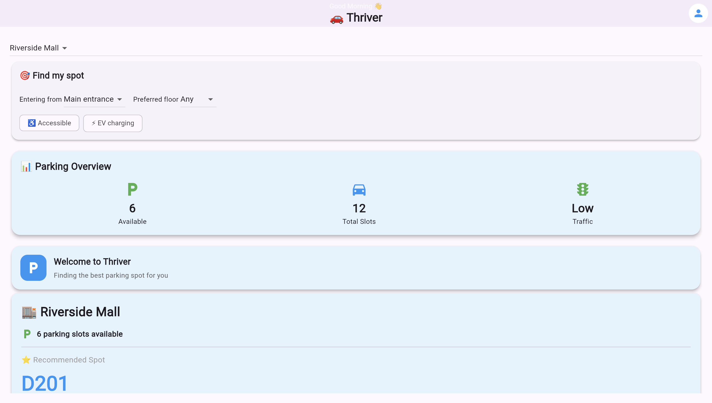
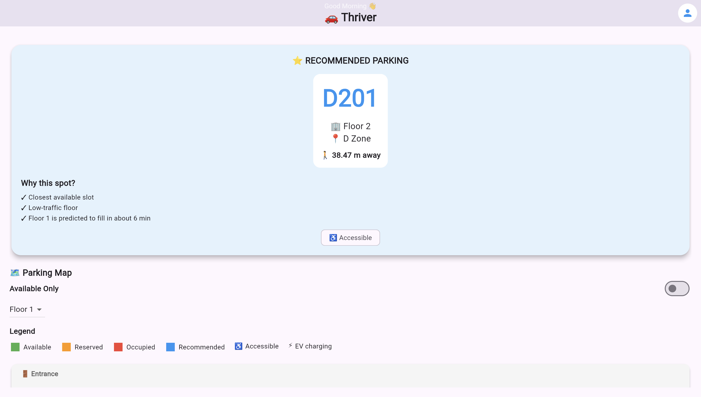
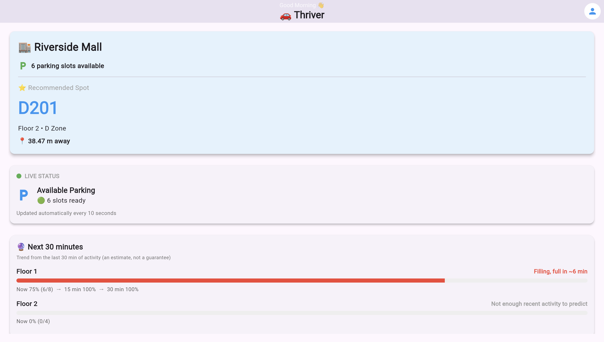
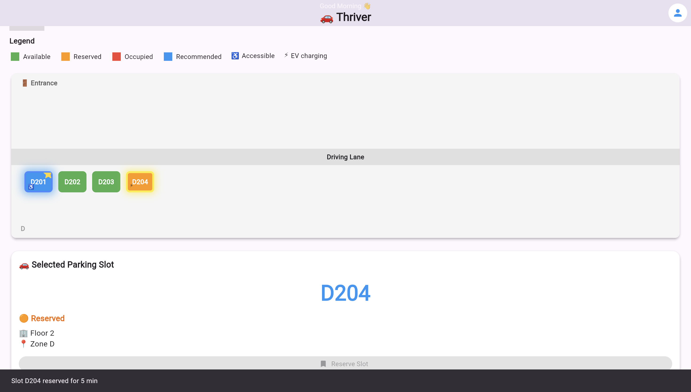
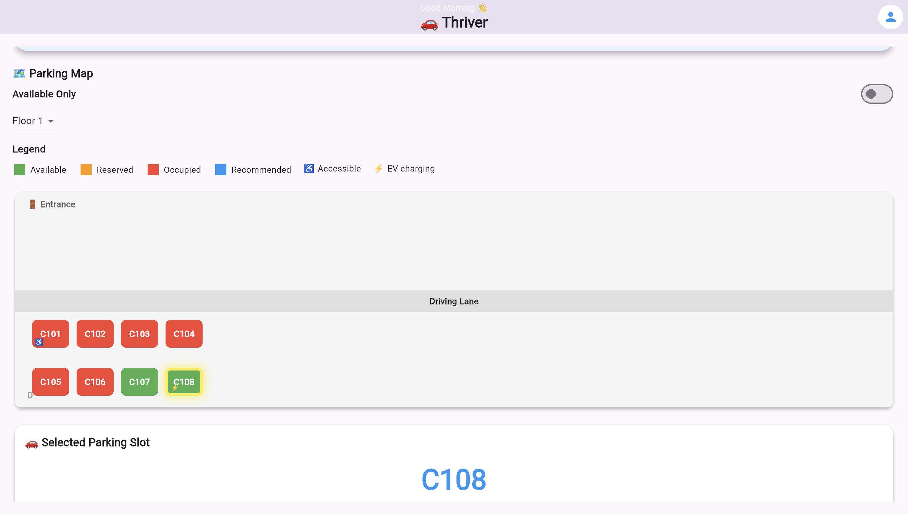
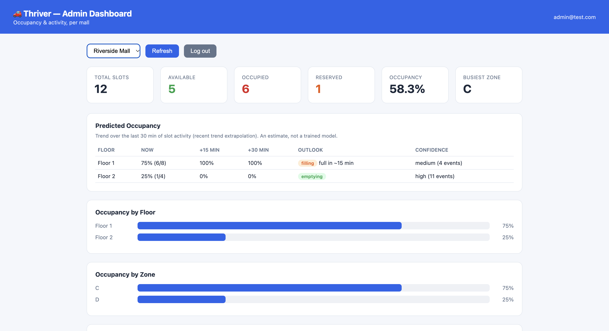
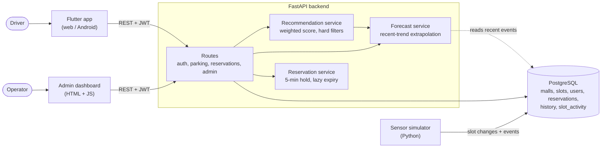

# Thriver

**Smart parking for malls.** Thriver shows a driver which parking slot to take, explains why, warns when a floor is about to fill up, and lets them hold the slot for a few minutes. Operators get a live dashboard.

> **Live demo:** LIVE_URL_HERE &nbsp;|&nbsp; **Demo video:** VIDEO_URL_HERE &nbsp;|&nbsp; **API docs:** `API_URL_HERE/docs`
>
> The backend runs on a free tier and sleeps when idle, so the first load can take 30 to 60 seconds.
| | |
|---|---|
|  |  |
|  |  |
|  |  |
## What it does

- **Recommends a slot and says why.** Every free slot is scored on walking distance from the chosen entrance, how busy its floor is (or is about to be), and an optional preferred floor. Accessible and EV-charging needs are hard filters, not score tweaks. The response includes human-readable reasons.
- **Forecasts floor occupancy.** For each floor: occupancy now, +15 and +30 minutes, an estimated "full in N min", a trend and a confidence level.
- **Reserves a slot for 5 minutes.** Reservations expire lazily (no scheduler), and the live map shows reserved slots separately.
- **Admin dashboard.** Occupancy by floor, predicted occupancy, and a live activity feed.
- **Accounts.** JWT auth, guest mode, per-user recommendation history.
- **Sensor simulator.** Generates realistic traffic, including a "rush" mode, so the live behaviour can be demonstrated without hardware.

## How the forecast works (and what it is not)

The forecast is **trend extrapolation, not a trained machine-learning model.** It reads the last 30 minutes of the `slot_activity` event log, counts slots that became taken minus slots that became free, and turns that into a net fill rate per floor. It then projects the current occupancy forward and clamps it to the floor's capacity.

It knows nothing about time of day, weekends or events, and it assumes the recent trend continues. With fewer than 3 recent events it reports `unknown` instead of extrapolating noise. A real model would learn weekly patterns from weeks of history; this uses minutes. The recommendation engine consumes the forecast, so a floor that is filling quickly is penalised before it is full.

Code: [`forecast_service.py`](backend/app/services/forecast_service.py), [`recommendation_service.py`](backend/app/services/recommendation_service.py). Both are pure functions with unit tests.

## Architecture



## Tech stack

| Layer | Choice |
|---|---|
| App | Flutter (web and Android) |
| API | Python, FastAPI, Pydantic v2 |
| Data | PostgreSQL, SQLAlchemy 2.0 |
| Auth | JWT (python-jose), bcrypt |
| Simulator | Python |
| Delivery | Docker, docker-compose, Render, Netlify |

## API overview

Interactive docs are served at `/docs`. Endpoints marked "optional" work without a token but personalise or log history when one is sent.

| Method | Path | Auth | Purpose |
|---|---|---|---|
| POST | `/auth/register` | none | Create an account (`admin_secret` makes an admin) |
| POST | `/auth/login` | none | Returns a bearer token (form fields, `username` is the email) |
| GET | `/auth/me` | required | Current profile |
| GET | `/malls` | none | List malls |
| GET | `/parking/available?mall_id=` | none | Free slots |
| GET | `/parking/map?mall_id=` | none | Every slot with status and coordinates |
| GET | `/parking/recommend` | optional | Best slot plus `reasons`. Params: `mall_id`, `entrance_x`, `entrance_y`, `preferred_floor`, `requires_accessible`, `requires_ev_charging` |
| GET | `/parking/forecast?mall_id=` | none | Per-floor outlook |
| GET | `/parking/history` | required | The user's past recommendations |
| POST | `/reservations` | required | Hold a slot for 5 minutes |
| GET | `/reservations/active` | required | Current hold, with seconds remaining |
| POST | `/reservations/{id}/release` | required | Release a hold early |
| GET | `/admin/stats` | admin | Occupancy by floor and zone |
| GET | `/admin/activity` | admin | Recent slot events |
| GET | `/health` | none | Liveness probe |

## Engineering notes

Things that went wrong and what they taught me:

- **Timezone bug on PostgreSQL.** Reservation countdowns read about 20,000 seconds instead of 300 when the database session was in IST. Naive `DateTime` columns were being interpreted in local time. Fix: timezone-aware columns, verified in IST, UTC and Los Angeles sessions. SQLite had hidden it.
- **Foreign keys differ by database.** Re-seeding worked on SQLite and failed on PostgreSQL because SQLite does not enforce them. Found by running the same tests on both.
- **Stale UI state across malls.** A slot popup survived switching malls. Fixed with request-id guards on async loads and a render-time check on the slot's mall.
- **Production safety.** With `ENV=production` the API refuses to boot with default secrets or `ALLOWED_ORIGINS=*`.
- **Lazy reservation expiry.** No background scheduler to run or monitor: stale holds are released when the next request touches them.

## Tests

```
cd backend
python -m tests.test_recommendation
python -m tests.test_forecast
```

Pure unit tests, no database or server needed. Scoring, filters, tie stability, forecast maths, clamping, the "unknown" threshold and the recommendation changing when a floor is predicted to fill.

## Roadmap

Real sensor integration, a model trained on weeks of history (seasonality), push notifications, Redis for rate limiting and caching.

---

## Running locally

### Backend

Requires Python 3.10+ and a running PostgreSQL.

```
createdb thriver_db
cd backend
python3 -m venv .venv
source .venv/bin/activate
pip install -r requirements.txt
cp .env.example .env          # adjust DATABASE_URL and SECRET_KEY if needed
python -m scripts.seed_data   # 3 demo malls with different layouts
uvicorn app.main:app --reload
```

Tables are created automatically on startup but existing tables are never
altered, so after pulling a change that adds columns, recreate the dev
database (`dropdb thriver_db && createdb thriver_db`) and re-seed.

Docs available at `http://127.0.0.1:8000/docs` once running.

**Auth:** register at `POST /auth/register`, log in at `POST /auth/login`
(form-encoded `username`/`password` — `username` is the email), then pass
`Authorization: Bearer <token>` on subsequent requests. `GET /auth/me`
returns the current profile; `GET /parking/history` returns the logged-in
user's past recommendations.

**Recommendations:** `GET /parking/recommend` scores every free slot by
distance from the caller's entrance (`entrance_x`, `entrance_y`), how busy
that slot's floor is, and an optional `preferred_floor`. `requires_accessible`
and `requires_ev_charging` are hard filters. The response includes a
`reasons` list explaining the choice. Scoring lives in
`backend/app/services/recommendation_service.py` (plain weighted heuristic,
no trained model).

**Occupancy forecast:** `GET /parking/forecast?mall_id=1` returns, per floor,
the current occupancy, a projection 15 and 30 minutes ahead, an estimated
"full in N min", a trend (`filling` / `steady` / `emptying` / `unknown`) and a
confidence level. Be clear about what this is: **trend extrapolation over the
last 30 minutes of slot activity, not a trained model.** It knows nothing about
time of day or weekends, and with fewer than 3 recent events it answers
`unknown` rather than guessing. `/parking/recommend` uses the predicted
occupancy in its traffic penalty and mentions floors about to fill in its
`reasons`. Code: `backend/app/services/forecast_service.py`.

**Demo data for the forecast:** a fresh database has no activity, so every
floor shows `unknown`. Two ways to produce a trend:

```
python -m scripts.backfill_activity            # from backend/; synthetic, idempotent
python simulator/parking_sensor.py --fill-bias 0.8 --interval 3   # from repo root; live "rush"
```

Backfilled rows are synthetic (source `backfill`) and are labelled as such in
the admin activity feed. The demo lots are tiny (about 23 slots), so a fast
rush fills them in seconds; that is expected.

**Tests:** from `backend/`, run `python -m tests.test_recommendation` and
`python -m tests.test_forecast`. Both are pure unit tests (no database or
server needed).

**Timestamps / PostgreSQL:** datetime columns are timezone-aware. If you ran
an earlier version, recreate the dev database (`dropdb thriver_db && createdb
thriver_db`) and re-seed, because existing tables are not altered.

**Admin access:** pass `admin_secret` matching `ADMIN_SIGNUP_SECRET`
(see `.env.example`) when calling `POST /auth/register` to create an admin
account. Admin dashboard lives at `http://127.0.0.1:8000/admin-dashboard/`
— a plain HTML/JS page (no build step) showing occupancy by floor/zone and
recent slot activity and a predicted-occupancy table, per mall. Run the simulator (`python simulator/parking_sensor.py`
from the repo root) alongside the backend to see live activity show up.

### Docker

```
docker compose up --build
```

Starts Postgres and the API together and seeds demo data. See
[DEPLOY.md](DEPLOY.md) for the free cloud deploy (Render + Netlify), web and
Android builds, and every environment variable. Set `ENV=production` and the
backend refuses to boot with default secrets or `ALLOWED_ORIGINS=*`.

### Mobile app

```
cd mobile/thriver_app
flutter pub get
flutter run --dart-define=API_BASE_URL=http://127.0.0.1:8000
```

`API_BASE_URL` defaults to `http://127.0.0.1:8000` if omitted, so this is
only required when pointing at a non-local backend (e.g. a physical device
or a deployed API).

---

## Architecture notes

- **Backend config** lives in `app/config.py` and reads from environment
  variables (see `.env.example`), so the database URL, CORS origins, and
  JWT secret are never hardcoded.
- **`app/dependencies.py`** holds the single shared `get_db()` used by every
  route, instead of each route file redefining it.
- **`app/schemas/`** holds Pydantic response models, so FastAPI validates
  and documents API responses instead of leaking raw SQLAlchemy objects.
- **`app/services/recommendation_service.py`** is a pure function over slot
  objects (no database or web code), which is why it can be unit tested with
  hand-built slots.
- **`app/services/forecast_service.py`** is also pure (slots and events in,
  per-floor forecasts out), with a thin database wrapper for the routes.
- **`app/auth/`** holds password hashing (raw `bcrypt`, not passlib — see
  code comment for why) and JWT creation/verification, plus the
  `get_current_user` / `get_current_user_optional` FastAPI dependencies used
  to protect routes.
- **Flutter `lib/`** is split by responsibility: `models/` (data classes),
  `services/` (API + auth clients), `screens/` (page-level state), `widgets/`
  (presentational pieces), `config/` (build-time config like the API base
  URL via `--dart-define`). The auth token is held in memory only for now —
  see the comment in `services/auth_service.dart` for the tradeoff and how
  to swap in persistent storage later.