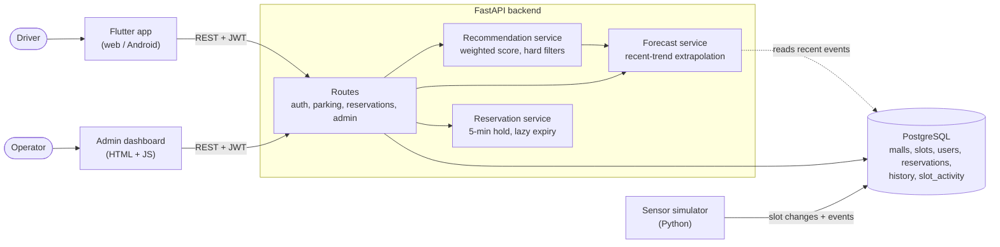

# Thriver system architecture

## Components

- **Flutter app**: map, recommendation, forecast, reservations, history.
- **Admin dashboard**: static HTML/JS served by the API at `/admin-dashboard/`.
- **FastAPI backend**: thin routes over pure service functions (recommendation, forecast), so the logic is unit tested without a database.
- **PostgreSQL**: source of truth. `slot_activity` is an event log that feeds both the admin feed and the forecast.
- **Simulator**: stands in for parking sensors by flipping slots and logging events.
